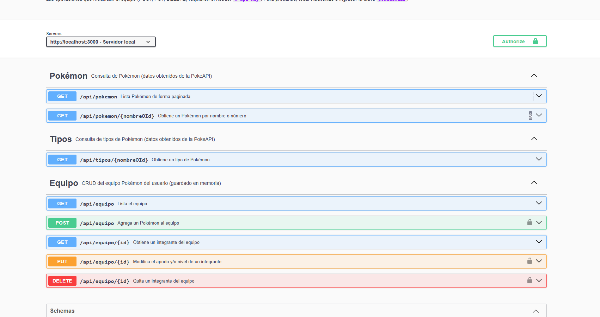
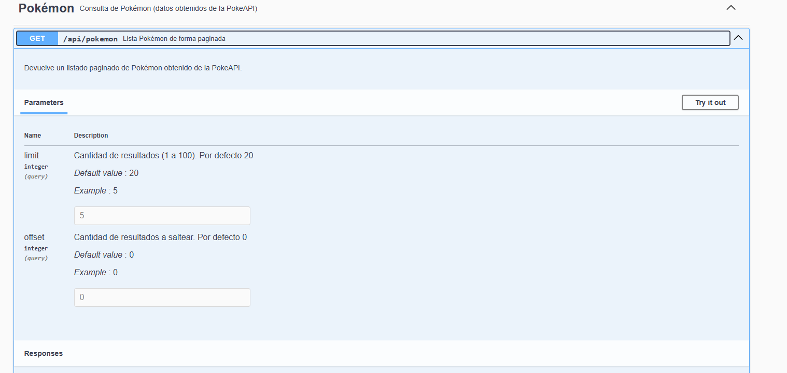
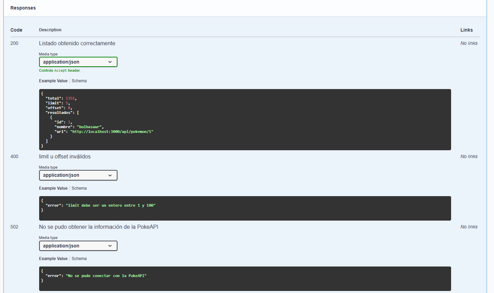
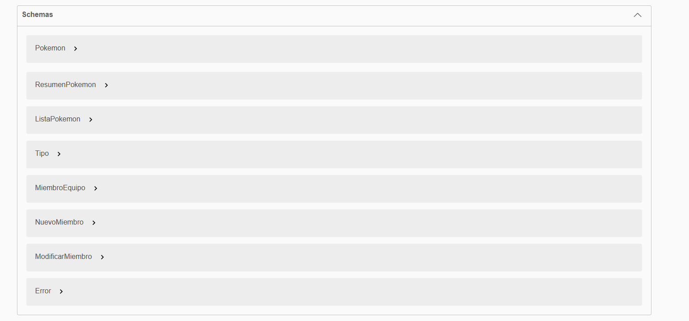

# TP – Documentación de una API con Swagger

**Integrantes:** Abreu y Kampel
**Proyecto base:** TP05 – Mini Pokédex

---

## 1. Selección y análisis de la API

### Proyecto seleccionado

**Mini Pokédex (TP05_DAI_Pita_Wolman_Kampel).** Página web donde el usuario escribe el nombre o número de un Pokémon y se muestra su imagen, tipo, peso y altura. Si el Pokémon no existe, se muestra un mensaje de error.

### Tipo de API

El TP05 original consumía directamente desde el navegador una **API externa**: la [PokeAPI](https://pokeapi.co). Esa API es de solo lectura (todo es `GET`) y no se puede documentar con `swagger-autogen`, porque esta herramienta lee el código de un servidor Node.js.

Por eso agregamos al proyecto un **servidor propio en Node.js + Express** que:

- funciona de intermediario con la PokeAPI (los endpoints de Pokémon y Tipos), devolviendo los datos ya simplificados y en español;
- suma un recurso propio, **Equipo**, con un CRUD completo (alta, consulta, modificación y baja) para tener operaciones `POST`, `PUT` y `DELETE`.

La página de la Mini Pokédex ahora consulta nuestro servidor en lugar de llamar a la PokeAPI directamente.

### Justificación de la elección

- Era el TP en el que más trabajamos con una API y ya teníamos la colección de Postman con las consultas.
- Al tener un servidor propio podemos usar las herramientas vistas en clase (`swagger-autogen` y `swagger-ui-express`).
- Combina una API externa (PokeAPI) con una propia, lo que permite documentar errores de los dos tipos: los de validación nuestros y los que vienen de la PokeAPI.
- Supera los 6 endpoints recomendados (tiene 8) y cubre GET, POST, PUT y DELETE.

### URL base

| API | URL base |
|---|---|
| API propia (documentada con Swagger) | `http://localhost:3000/api` |
| API externa consumida | `https://pokeapi.co/api/v2` |

### Endpoints

| Método | Endpoint | Descripción | Usa de la PokeAPI |
|---|---|---|---|
| GET | `/api/pokemon?limit=&offset=` | Lista Pokémon de forma paginada | `GET /pokemon?limit=&offset=` |
| GET | `/api/pokemon/{nombreOId}` | Obtiene un Pokémon por nombre o número (lo usa la página) | `GET /pokemon/{nombreOId}` |
| GET | `/api/tipos/{nombreOId}` | Obtiene un tipo con sus debilidades y fortalezas | `GET /type/{nombreOId}` |
| GET | `/api/equipo` | Lista todos los integrantes del equipo | — |
| GET | `/api/equipo/{id}` | Obtiene un integrante del equipo | — |
| POST | `/api/equipo` | Agrega un Pokémon al equipo (valida que exista) | `GET /pokemon/{nombre}` |
| PUT | `/api/equipo/{id}` | Modifica el apodo y/o nivel de un integrante | — |
| DELETE | `/api/equipo/{id}` | Quita un integrante del equipo | — |

---

## 2. Acceso a Swagger

```bash
npm install
npm start
```

| Qué | URL |
|---|---|
| **Swagger UI** | **http://localhost:3000/api-docs** |
| Mini Pokédex (página) | http://localhost:3000 |

Las operaciones `POST`, `PUT` y `DELETE` piden autenticación: en Swagger UI tocar **Authorize** e ingresar la clave `pokedex123`.

---

## 3. Implementación de Swagger

### Dependencias

| Paquete | Para qué se usa |
|---|---|
| `express` | Servidor y rutas de la API |
| `swagger-autogen` | Genera `swagger-output.json` (especificación OpenAPI 3.0) leyendo `app.js` |
| `swagger-ui-express` | Muestra la especificación como página web en `/api-docs` |

### Archivos

| Archivo | Contenido |
|---|---|
| `app.js` | Servidor Express, endpoints y comentarios `#swagger` de cada uno |
| `swagger.js` | Configuración de swagger-autogen: título, servidor, tags, modelos y seguridad |
| `swagger-output.json` | Especificación generada (no se edita a mano) |
| `public/` | Página de la Mini Pokédex (HTML, CSS y JS) |

### Funcionamiento

1. `swagger.js` define los datos generales de la documentación y los **modelos** (`components.@schemas`).
2. Cada endpoint de `app.js` tiene un comentario con `#swagger.tags`, `#swagger.summary`, `#swagger.parameters`, `#swagger.requestBody`, `#swagger.responses` y `#swagger.security`.
3. `npm start` primero ejecuta `node swagger.js`, que lee esos comentarios y genera `swagger-output.json`, y después levanta el servidor.
4. `app.js` sirve ese archivo con `swagger-ui-express`:

```js
const swaggerUi = require("swagger-ui-express");
const swaggerFile = require("./swagger-output.json");
app.use("/api-docs", swaggerUi.serve, swaggerUi.setup(swaggerFile));
```

Ejemplo de documentación de un endpoint:

```js
app.get("/api/pokemon/:nombreOId", async (req, res) => {
  /* #swagger.tags = ['Pokémon']
     #swagger.summary = 'Obtiene un Pokémon por nombre o número'
     #swagger.parameters['nombreOId'] = {
       in: 'path', description: 'Nombre o número de Pokédex', required: true,
       schema: { type: 'string' }, example: 'pikachu'
     }
     #swagger.responses[200] = {
       description: 'Pokémon encontrado',
       content: { 'application/json': { schema: { $ref: '#/components/schemas/Pokemon' } } }
     }
     #swagger.responses[404] = { description: 'No existe un Pokémon con ese nombre o número', ... }
  */
  ...
});
```

### Extras del desafío opcional que incluimos

- **Autenticación:** API key en el header `x-api-key`, configurada como `securityScheme` (botón Authorize).
- **Tags:** los endpoints están agrupados en *Pokémon*, *Tipos* y *Equipo*.
- **Ejemplos** de request y response en todos los endpoints.
- **Respuestas diferentes según el resultado**, incluyendo varios ejemplos de error 400 en el POST.
- **Errores específicos** de la aplicación con mensajes propios (equipo lleno, nivel fuera de rango, etc.).
- **Modelos detallados** con descripción, tipo, formato, mínimos y máximos de cada propiedad.

---

## 4. Modelos de datos

### Pokemon

```json
{
  "id": 25,
  "nombre": "pikachu",
  "imagen": "https://raw.githubusercontent.com/PokeAPI/sprites/master/sprites/pokemon/25.png",
  "tipos": ["electric"],
  "peso": 60,
  "altura": 4
}
```

| Propiedad | Tipo | Descripción |
|---|---|---|
| id | integer | Número de Pokédex nacional |
| nombre | string | Nombre en minúsculas |
| imagen | string (URL) o null | Sprite frontal |
| tipos | array de string | Tipos del Pokémon |
| peso | integer | Peso en hectogramos (60 = 6 kg) |
| altura | integer | Altura en decímetros (4 = 0,4 m) |

### ListaPokemon / ResumenPokemon

```json
{
  "total": 1351,
  "limit": 3,
  "offset": 0,
  "resultados": [
    { "id": 1, "nombre": "bulbasaur", "url": "http://localhost:3000/api/pokemon/1" }
  ]
}
```

| Propiedad | Tipo | Descripción |
|---|---|---|
| total | integer | Cantidad total de Pokémon existentes |
| limit | integer | Cantidad pedida por página |
| offset | integer | Posición desde la que se listó |
| resultados | array de ResumenPokemon | `id` (integer), `nombre` (string), `url` (string, detalle en esta API) |

### Tipo

```json
{
  "id": 10,
  "nombre": "fire",
  "debilContra": ["ground", "rock", "water"],
  "fuerteContra": ["bug", "steel", "grass", "ice"],
  "cantidadPokemon": 109
}
```

| Propiedad | Tipo | Descripción |
|---|---|---|
| id | integer | Identificador del tipo |
| nombre | string | Nombre del tipo |
| debilContra | array de string | Tipos que le hacen doble daño |
| fuerteContra | array de string | Tipos a los que les hace doble daño |
| cantidadPokemon | integer | Cantidad de Pokémon con este tipo |

### MiembroEquipo

```json
{
  "id": 1,
  "pokemonId": 25,
  "nombre": "pikachu",
  "apodo": "Pika",
  "nivel": 15,
  "imagen": "https://raw.githubusercontent.com/PokeAPI/sprites/master/sprites/pokemon/25.png"
}
```

| Propiedad | Tipo | Descripción |
|---|---|---|
| id | integer | Id del integrante dentro del equipo |
| pokemonId | integer | Número de Pokédex |
| nombre | string | Nombre de la especie |
| apodo | string | Apodo elegido por el usuario |
| nivel | integer (1–100) | Nivel |
| imagen | string (URL) o null | Sprite frontal |

### NuevoMiembro (body del POST)

| Propiedad | Tipo | Obligatorio | Descripción |
|---|---|---|---|
| pokemon | string | Sí | Nombre o número del Pokémon |
| apodo | string | No | Si no se envía, se usa el nombre |
| nivel | integer (1–100) | No | Por defecto 5 |

### ModificarMiembro (body del PUT)

| Propiedad | Tipo | Descripción |
|---|---|---|
| apodo | string | Nuevo apodo |
| nivel | integer (1–100) | Nuevo nivel |

Se debe enviar al menos una de las dos.

### Error

```json
{ "error": "Pokémon no encontrado" }
```

---

## 5. Códigos de respuesta

| Código | Significado en esta API | Endpoints |
|---|---|---|
| 200 | Operación exitosa | Todos los GET, PUT y DELETE |
| 201 | Integrante creado | POST `/api/equipo` |
| 400 | Datos inválidos: `limit`/`offset` fuera de rango, id no numérico, falta `pokemon`, `nivel` fuera de 1–100, body vacío en el PUT, JSON mal formado, equipo con 6 integrantes | `/api/pokemon`, todos los de `/api/equipo` menos el GET general |
| 401 | Falta el header `x-api-key` o es incorrecto | POST, PUT y DELETE de `/api/equipo` |
| 404 | No existe el Pokémon, el tipo o el integrante | `/api/pokemon/{nombreOId}`, `/api/tipos/{nombreOId}`, POST/GET/PUT/DELETE de `/api/equipo` |
| 502 | No se pudo obtener la respuesta de la PokeAPI | Endpoints que consultan la PokeAPI |
| 500 | Error inesperado del servidor (lo maneja el middleware de errores) | Cualquiera |

---

## 6. Pruebas realizadas

Las pruebas se ejecutaron contra la API en funcionamiento. Se pueden repetir desde Swagger UI con **Try it out → Execute**; para las de Equipo primero hay que cargar la clave `pokedex123` con **Authorize**.

| # | Prueba | Request | Código esperado | Código obtenido | Respuesta |
|---|---|---|---|---|---|
| 1 | GET con parámetros de consulta | `GET /api/pokemon?limit=3&offset=0` | 200 | 200 | `total`, `limit`, `offset` y 3 resultados (bulbasaur, ivysaur, venusaur) |
| 2 | GET con parámetro de ruta | `GET /api/pokemon/pikachu` | 200 | 200 | `{"id":25,"nombre":"pikachu","tipos":["electric"],"peso":60,"altura":4,...}` |
| 3 | GET con error | `GET /api/pokemon/noexiste` | 404 | 404 | `{"error":"Pokémon no encontrado"}` |
| 4 | GET de tipo | `GET /api/tipos/fire` | 200 | 200 | `debilContra: ground, rock, water` |
| 5 | GET de tipo inexistente (el "error intencional" de Postman) | `GET /api/tipos/pokemon` | 404 | 404 | `{"error":"Tipo no encontrado"}` |
| 6 | POST sin autorización | `POST /api/equipo` sin API key | 401 | 401 | `{"error":"Falta el header x-api-key o la clave es incorrecta"}` |
| 7 | POST | `POST /api/equipo` con `{"pokemon":"pikachu","apodo":"Pika","nivel":15}` | 201 | 201 | Integrante con `id: 1`, `pokemonId: 25` |
| 8 | POST con datos inválidos | `{"pokemon":"x","nivel":200}` | 400 | 400 | `{"error":"nivel debe ser un entero entre 1 y 100"}` |
| 9 | POST con Pokémon inexistente | `{"pokemon":"agumon"}` | 404 | 404 | `{"error":"Pokémon no encontrado"}` |
| 10 | GET por id | `GET /api/equipo/1` | 200 | 200 | El integrante creado en la prueba 7 |
| 11 | PUT | `PUT /api/equipo/1` con `{"apodo":"Chispita","nivel":30}` | 200 | 200 | Integrante con el apodo y nivel nuevos |
| 12 | PUT sin campos | `PUT /api/equipo/1` con `{}` | 400 | 400 | `{"error":"Enviá al menos apodo o nivel"}` |
| 13 | DELETE | `DELETE /api/equipo/1` | 200 | 200 | Devuelve el integrante eliminado |
| 14 | DELETE repetido | `DELETE /api/equipo/1` | 404 | 404 | `{"error":"No hay ningún integrante con id 1"}` |
| 15 | Equipo lleno | 7.º `POST /api/equipo` | 400 | 400 | `{"error":"El equipo ya tiene 6 integrantes"}` |

En todas se verificó que la solicitud se ejecutó, que el body enviado era el esperado, que la respuesta coincide con el modelo documentado y que el código HTTP es el documentado.

---

## 7. Capturas

### Interfaz principal de Swagger
Vista general de `/api-docs` con los 8 endpoints agrupados por tag (Pokémon, Tipos y Equipo), el selector de servidor y el botón **Authorize**. Los endpoints que requieren API key muestran un candado.



### Endpoint documentado: parámetros
`GET /api/pokemon` con su descripción y los parámetros de consulta `limit` y `offset` (tipo integer, valor por defecto y ejemplo).



### Endpoint documentado: respuestas
Respuestas documentadas del mismo endpoint: 200 (con el modelo ListaPokemon), 400 y 502, cada una con su ejemplo.



### Modelos
Sección Schemas con los 8 modelos de la API.



---

## 8. Problemas encontrados y soluciones

| Problema | Solución |
|---|---|
| El TP05 no tenía servidor: era HTML + JS que llamaba a la PokeAPI desde el navegador, y `swagger-autogen` necesita un servidor Node.js para leer las rutas. | Creamos un servidor Express que hace de intermediario con la PokeAPI y cambiamos `index.js` para que consulte `/api/pokemon/...`. |
| La PokeAPI es de solo lectura, así que no había POST, PUT ni DELETE para probar. | Agregamos el recurso **Equipo** con un CRUD propio guardado en memoria. |
| Si se servía la carpeta raíz como estática, cualquiera podía ver `app.js` desde el navegador. | Movimos la página a `public/` y solo se sirve esa carpeta. |
| Las respuestas de la PokeAPI son muy grandes (cientos de campos) y difíciles de documentar. | El servidor devuelve solo los campos que usa la página, con nombres en español, y esos son los modelos documentados. |
| Al ejecutar el servidor en la red del colegio, todas las consultas a la PokeAPI fallaban con `SELF_SIGNED_CERT_IN_CHAIN` (la red revisa el tráfico HTTPS con un certificado propio que Windows acepta pero Node.js no). | Se inicia Node con `--use-system-ca` (incluido en `npm start`) para que use los certificados de Windows. Además, si la PokeAPI no responde, la API devuelve un **502** con un mensaje claro en lugar de cortarse. |
| Por defecto swagger-autogen genera los modelos a partir de un ejemplo y no permite describir cada propiedad. | Definimos los modelos con `@schemas` en `swagger.js`, que acepta JSON Schema completo (descripción, tipo, mínimo, máximo). |
| Hacía falta que el body de POST y PUT apareciera como JSON editable en Swagger UI. | Generamos la especificación en OpenAPI 3.0 (`openapi: "3.0.0"`) y usamos `#swagger.requestBody`. |
| En Swagger UI, los parámetros `limit` y `offset` aparecían como tipo `object` en vez de `integer`: swagger-autogen tomaba el `schema` del parámetro como si fuera un ejemplo. | Usamos `'@schema'` en lugar de `schema` en esos parámetros, para que swagger-autogen copie el esquema tal cual. |
| Las respuestas de error sin ejemplo propio (401, 502, etc.) mostraban "Pokémon no encontrado", el ejemplo general del modelo `Error`. | Agregamos a cada respuesta de error su ejemplo con el mensaje real que devuelve la API. |
